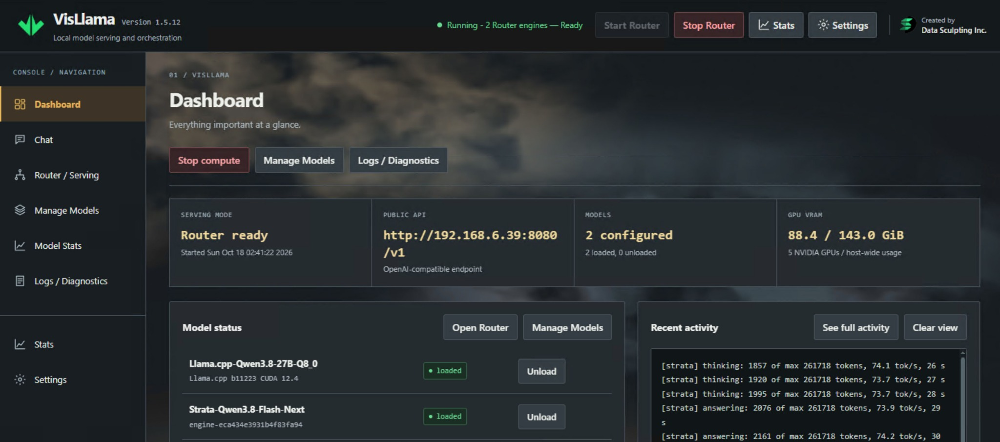

# VisLlama

**Version 1.5.12** · A Windows and Linux browser administration console for local
inference engines, with built-in llama.cpp support and experimental Strata support.
Created by [Data Sculpting Inc.](https://datasculpting.com/).

VisLlama manages named builds, model presets, GPU settings and loaded processes
behind one public OpenAI-compatible Router endpoint. Integrated Chat provides
streaming, local history, Markdown/code/math rendering and response statistics.

## Screenshots

Manage models from multiple engines behind one public endpoint, with load status,
hardware readings and recent activity in one place.

[View the full screenshot tour](docs/SCREENSHOTS.md) ·
[Chat](docs/SCREENSHOTS.md#chat) ·
[GPU priority settings](docs/SCREENSHOTS.md#calculated-gpu-priority)

## Getting started

1. Install Perl: [Strawberry Perl](https://strawberryperl.com/) on Windows, or the
   full `perl` package on Linux. Check `perl -v` in a new terminal.
2. Obtain a working llama.cpp build and GGUF models, or a prepared supported
   external-engine installation. Engines and model weights are installed separately.
3. Extract or clone the complete repository into a writable directory.
4. Run `perl VisLlama.pl` and open the printed management URL, normally
   <http://127.0.0.1:9090/>. Keep the terminal running.
5. Register a named engine build. For llama.cpp, also set the GGUF model root
   in Settings. The root is optional for other engine types.
6. Add model presets in Manage Models, start Router, and load a model. Open Chat
   or connect a client to the public inference endpoint shown by VisLlama.

See [Installation](docs/INSTALLATION.md) for platform modules, GPU prerequisites,
Linux Docker access and upgrades. Node, npm and a frontend build are not required
by VisLlama at runtime. External engines and monitoring tools have their own dependencies.

## Features

- Native llama.cpp builds and Linux Docker images with named build aliases.
- One public Router and one sortable model catalog with sequential startup.
- Shared model editor with Edit/Clone, preview, Save and Save and load/reload.
- llama.cpp native fitting and Calculated priority placement using fresh VRAM.
- Reusable declarative engine definitions, per-installation capability discovery
  and editable model controls; Strata is the experimental reference engine.
- Native JSON import, preserved unknown settings and library-folder list controls.
- Integrated Chat with model-default sampling/output settings and optional overrides.
- GPU/CPU/RAM statistics, operational logs and referenced private diagnostics.
- Optional AMD/Intel monitoring through supported installed vendor tools.

## Documentation

| Guide | Contents |
| --- | --- |
| [Installation](docs/INSTALLATION.md) | Windows/Linux prerequisites, setup, Docker and upgrades |
| [Screenshot tour](docs/SCREENSHOTS.md) | Dashboard, Chat, model controls, statistics and settings |
| [Usage](docs/USAGE.md) | Catalog, saving/loading, GPU settings, Chat and logs |
| [Engine extensions](docs/ENGINES.md) | Engine setup, definition schema and discovery contracts |
| [Troubleshooting](docs/TROUBLESHOOTING.md) | Diagnostics, GPU loading and known limitations |
| [Architecture](docs/ARCHITECTURE.md) | Modules, frontend structure, state and process ownership |
| [Development](docs/DEVELOPMENT.md) | Test prerequisites, checks and contribution contracts |
| [Changelog](CHANGELOG.md) | Release history |

## Scope and access

Windows/NVIDIA is the primary target. Linux uses the same application and saved
formats. Real-host compatibility depends on the selected engine, model, drivers
and operating system. Fixture tests do not establish hardware or browser parity.
AMD/Intel monitoring does not enable verified placement or new Calculated modes.
Strata GPU settings remain engine-native; its automatic fitting is not VisLlama's
llama.cpp Calculated planner. Shared-GPU loading can exhaust available memory.

The administration interface controls host files and processes and has **no
authentication**. Its default bind is loopback; restrict access to trusted users.
Error redaction and Router CORS are not authentication. Review imported engine
configurations and definitions: their processes run under the VisLlama account.

## Upgrading

Stop VisLlama and its managed processes. Back up and retain `presets/` and `logs/`,
then replace application files together. Those directories contain host state and
are intentionally excluded from this repository. Export browser-local Chat history
before clearing browser data or changing the management URL's origin.

## License and credits

Copyright (C) 2026 Data Sculpting Inc. VisLlama is licensed under GNU GPL version 3
only, with separate Section 7 copyright-notice and origin-preservation terms.
See [LICENSE](LICENSE) and [ADDITIONAL_TERMS.md](ADDITIONAL_TERMS.md).
Visual branding and website links are voluntary requests, not license conditions.
Bundled browser libraries retain their own licenses; see
[THIRD_PARTY_NOTICES.md](THIRD_PARTY_NOTICES.md).

Project: <https://www.visllama.com/> · Other Data Sculpting AI projects:
<https://www.datasculpting.ai/>
