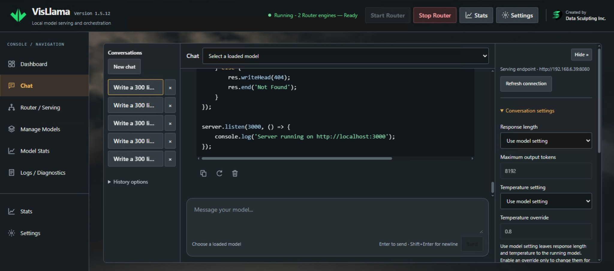
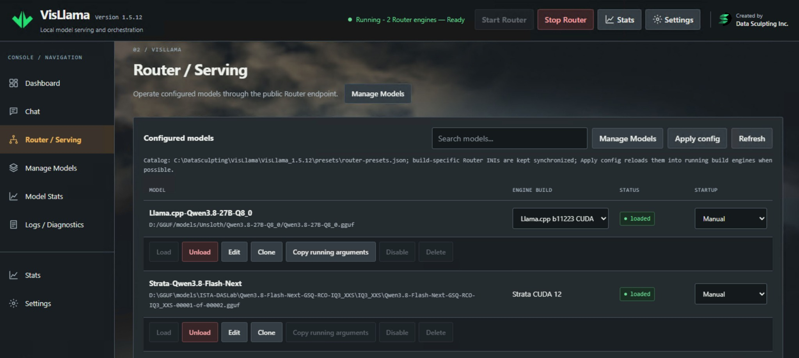
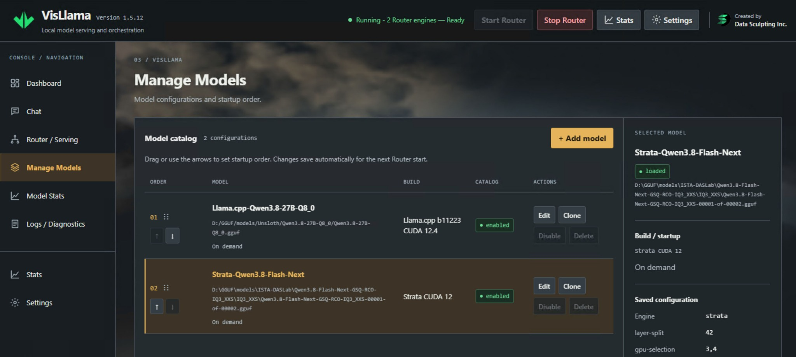
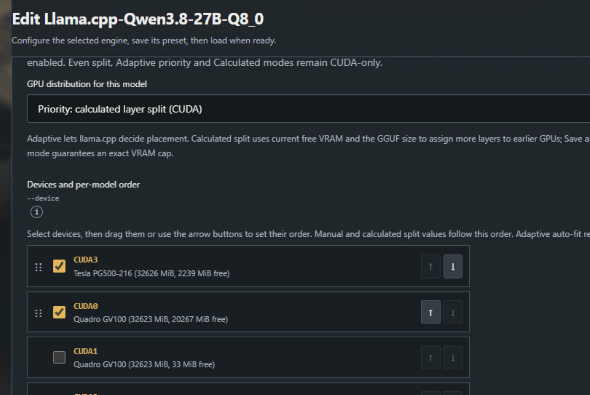
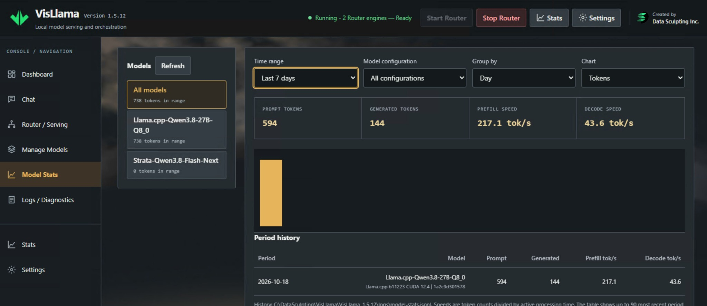
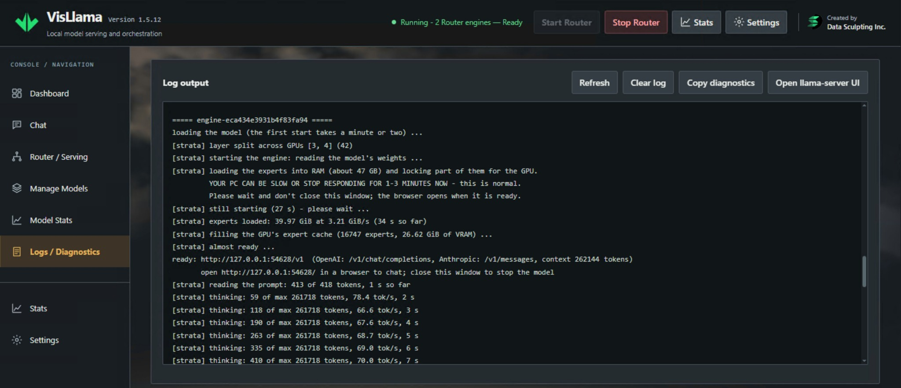
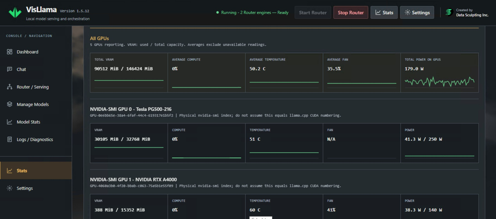
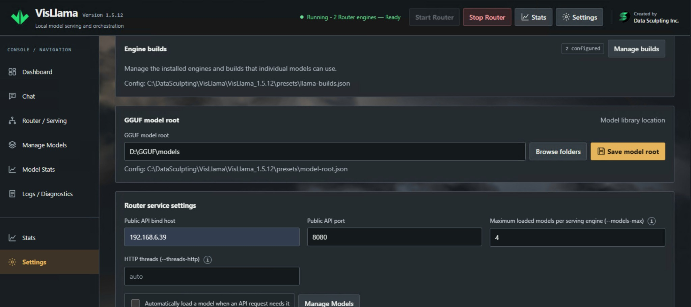

# Screenshot tour

[Back to README](../README.md) · [Usage guide](USAGE.md)

A tour of VisLlama 1.5.12 using a Windows installation with llama.cpp and Strata.
Click any image to view it at full size. Addresses, paths, model names and hardware
readings are examples from this installation; performance depends on the engine,
model, configuration and hardware.

| Operate | Configure | Inspect |
| --- | --- | --- |
| [Dashboard](#dashboard) | [Manage Models](#manage-models) | [Model Stats](#model-stats) |
| [Chat](#chat) | [Calculated GPU priority](#calculated-gpu-priority) | [Logs / Diagnostics](#logs-and-diagnostics) |
| [Router / Serving](#router-and-serving) | [Settings](#settings) | [System Stats](#system-stats) |

## Dashboard

The overview shows Router readiness, its public OpenAI-compatible address, model
counts, host-wide GPU memory usage and recent activity. Both the llama.cpp and
Strata presets are loaded in this example, with individual Unload controls.

**Also useful:** the public endpoint is shared across the configured engines.
The VRAM total describes host usage, not memory reserved exclusively by VisLlama.
Stop compute cancels inference by restarting the public proxy while retaining
loaded models; Stop Router stops the managed serving processes.

## Chat

Chat combines saved conversations, formatted responses and code blocks with a
message composer and a collapsible details pane. The right-hand settings show
response length and temperature in **Use model setting** mode. The model picker
asks for a loaded model before sending another message.

**Also useful:** in model-setting mode, Chat omits temperature and output-cap
request fields. The inactive numeric values visible underneath are not forced
settings. Chat also supports streaming, stopping a response, reasoning display,
Markdown/math and browser-local history with JSON export/import.

## Router and Serving

The serving view lists each configured model's alias, path, build, loaded status
and startup choice. Both shown models use manual loading. Per-model actions
include Load/Unload, Edit and Clone; the page also provides search, Refresh and
Apply config.

**Also useful:** saving a preset, publishing the live catalog and changing an
already loaded process are distinct operations. Use explicit reload actions to
apply changed model settings; new build/GPU groups can require Router restart.
Clients use the public endpoint rather than temporary child-server ports.

## Manage Models

One catalog holds presets from different engines. Drag handles and arrow buttons
set their order; Edit and Clone open the shared model editor. The selected Strata
row is highlighted, and its inspector shows the build, on-demand startup choice
and saved settings, including GPU selection and layer split.

**Also useful:** catalog order determines sequential startup for models enabled
to load at startup. Being enabled in the catalog does not itself mean a model
will load automatically. Each clone can retain its own configuration and alias.
The build selected in the editor determines which engine controls appear.

## Calculated GPU priority

This editor detail shows **Priority: calculated layer split (CUDA)**. GPUs can be
selected and reordered using drag handles or arrows. Device rows show build CUDA
identifiers, model names, capacity and available memory; selected devices receive
layers according to their order and the planner's estimates.

**Also useful:** Calculated loads take a fresh memory reading when planning a
load. The displayed values are a snapshot, not a guaranteed VRAM cap. Physical
UUID/PCI verification connects CUDA identifiers to hardware; NVIDIA-SMI indices
are not interchangeable with CUDA ordinals. This planner belongs to llama.cpp;
Strata uses its own GPU selection and split controls.

## Model Stats

Filters select a time range, model configuration, grouping and chart. Summary
cards show prompt/generated tokens and available prefill/decode rates, with a
chart and period table below. This example has recorded llama.cpp activity and
a Strata entry with no recorded tokens in the selected range.

**Also useful:** history depends on the usage/timing information available from
the engine. A zero-history entry does not by itself prove that the model has
never run. The rates shown are observations for that configuration and workload,
not a benchmark promise for another installation.

## Logs and Diagnostics

Operational output shows Strata starting with GPUs 3 and 4 and split point 42,
loading its experts/cache, reaching readiness and processing a request. The
screen provides Refresh, Clear log and Copy diagnostics controls.

**Also useful:** clearing the displayed log does not truncate the private disk
logs. Referenced errors can be correlated with diagnostic records and generated
launch snapshots. The loopback URL in an engine log is its internal endpoint;
external clients should use VisLlama's public Router address. Review copied
output for sensitive details before sharing it.

## System Stats

The Stats view shows aggregate readings for five reporting NVIDIA GPUs, followed
by individual device cards and short histories. Visible metrics include VRAM,
compute utilization, temperature, fan and power. Unsupported readings appear as
**N/A**, as illustrated by one device's fan value.

**Also useful:** GPU power is not whole-system power, and monitoring indices do
not establish inference-device mapping. CPU/RAM readings and optional AMD/Intel
provider information are available elsewhere in Stats when supported. AMD/Intel
monitoring uses installed vendor tools and does not enable verified placement.

## Settings

Settings brings together engine-build management, the GGUF model root and Router
service controls. The screenshot shows two configured builds, a local model
folder, the public bind host/port, maximum loaded models per serving engine and
HTTP threads.

**Also useful:** Router service settings are stored separately from model
presets. The GGUF root is used for llama.cpp presets and is optional for other
engines. The loaded-model limit is per serving engine, not a global memory budget.
HTTP threads applies to internal llama.cpp servers, not Strata or the public proxy.
See [Installation](INSTALLATION.md) before exposing the unauthenticated management
interface beyond trusted access.
